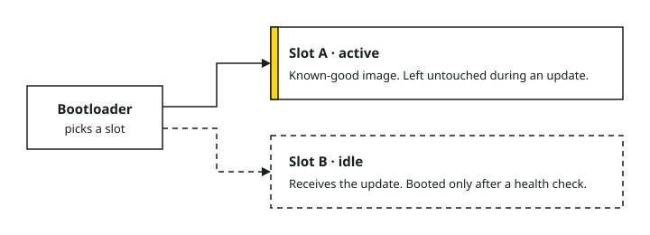

> **Sample entry.** This text came from the design mockups and exists to show every Markdown feature in the real layout. Replace it or delete the folder.

## A web deploy can be wrong for a minute

When a web service ships a bad build, the load balancer notices, traffic shifts, and the worst case is usually a spike on a dashboard. Rolling back takes one command, and the machines involved never leave the rack.

A robot is different in the ways that matter most. It is on a customer's floor, not in your datacenter. It may be mid-task when the update lands. And a bad build can do more than return a 500: it can move.[^refuse]

## Stage by blast radius, not by percentage

Percent-based rollouts assume every unit is interchangeable. Fleets are not: sites differ in hardware revision, network quality, and how much supervision is on hand. I order stages by how bad a failure would be, and let the percentage fall out of that.

| Stage           | Units                          | Soak | Gate to advance                           |
| --------------- | ------------------------------ | ---- | ----------------------------------------- |
| 0 · Bench       | Hardware-in-the-loop rigs      | 1 h  | Full regression suite passes              |
| 1 · Dogfood     | Units in our own building      | 24 h | No safety stops attributed to the build   |
| 2 · Canary      | One unit per hardware revision | 48 h | Health within baseline; operator sign-off |
| 3 · Early sites | Sites with on-call staff nearby | 72 h | No rollback requests                      |
| 4 · Fleet       | Everything else, by time zone  | n/a  | Automatic; any alert holds the wave       |

The canary stage is where most bad builds stop.

## Make the robot the last line of defence

The server decides who is offered a build. The robot decides whether to take it. That check runs on the unit, and it is deliberately boring:

```python
def may_install(build, unit):
    if unit.is_mid_task or unit.estop_engaged:
        return Defer("busy")
    if build.min_hw_rev > unit.hw_rev:
        return Refuse("hardware too old")
    if not unit.has_rollback_slot():
        return Refuse("no known-good image to fall back to")
    return Accept()
```

An update that cannot be undone on the unit, without the network, is not allowed to start. Each unit carries two bootable images; the updater writes the idle one and only switches after a health check passes.



None of this is novel. It is the same staged rollout every web team uses, re-sorted around the fact that the fleet has mass.

[^refuse]: Everything here assumes the robot can refuse an update. If yours cannot, fix that first.
